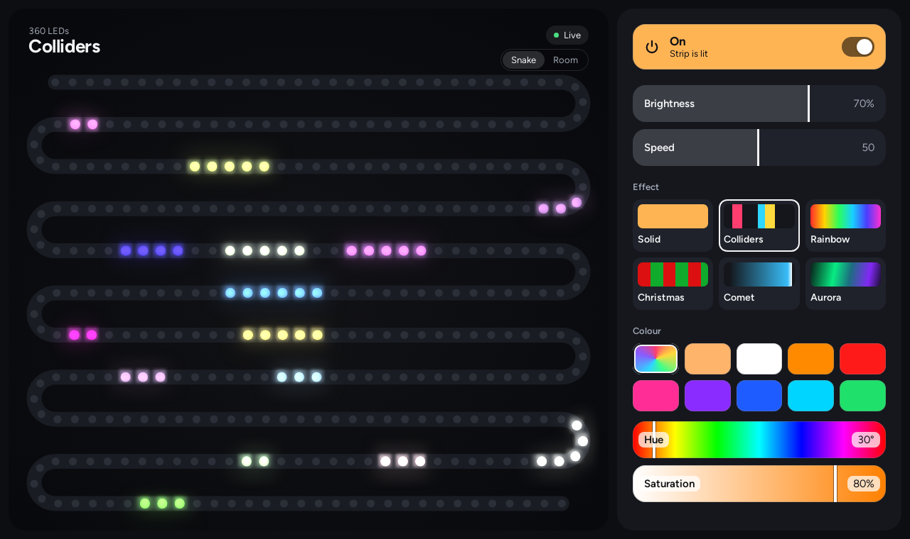
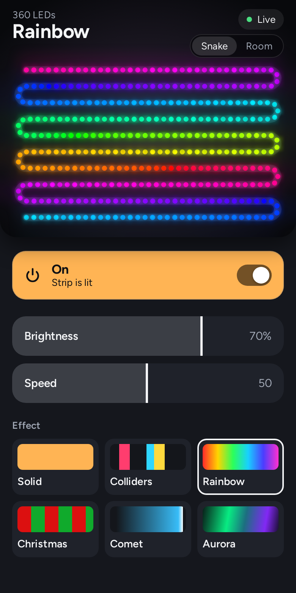

# leds-service

Web control and live mirror for a WS281x/NeoPixel strip on a Raspberry Pi.

The page shows what the strip is showing, frame by frame: the frames the browser draws are the
ones sent to the LEDs, so every effect works without being reimplemented in JavaScript.





The canonical source lives in the home-lab monorepo (`services/leds-service`) and is copied to
[github.com/gradrix/leds-service](https://github.com/gradrix/leds-service) with
`scripts/leds-upstream-sync.sh`, so commit changes in home-lab.

## Components

| Path | Image | What it does |
|---|---|---|
| `gpio_service/` + `gpio_api/` | `leds-gpio` | gRPC server (`:9000`) with the render loop that drives the strip through `rpi_ws281x`; effects in `gpio_service/ledprograms/` |
| `web_api/` + `ui/` | `leds-web` | Flask/gunicorn on `:80` serving the React UI, `/api/*`, and the live frame stream |

How a frame travels: a program draws into `FrameBuffer` on the render loop (`Controller.tick`, up to
50 fps). The loop writes it to the strip and publishes it on `FrameBus`. gRPC `StreamFrames` passes the
newest frame to each viewer (at most 30 fps), `/api/frames/` turns that into server-sent events, and
`ui/src/strip/StripCanvas.tsx` paints it. See
ADR 0003 in home-lab for why.

Only the render loop touches the hardware. Commands on gRPC threads change settings and wake it,
which is why a change shows on the next frame in every effect.

While the strip is off and someone is watching, programs keep drawing so effects can be previewed;
the hardware stays dark.

## Effects

Solid, Colliders, Rainbow, Christmas, Comet, Aurora.

To add one, drop a `LedProgramBase` subclass in `gpio_service/ledprograms/` with an unused `modeIndex`.
`render(seconds)` draws one frame and must not sleep. Use `self.speedScale()` (1 at speed 50, from 1/8
at 0 to 8 at 100) so the speed slider works; the UI picks the effect up by itself. An optional tile
picture is an `.art-<name>` rule in `ui/src/styles.css`.

## API

| Endpoint | Purpose |
|---|---|
| `GET /api/status/` | `isOn`, `brightness` (0-100), `mode`, `speed` (0-100, of the current effect), `color` (`rrggbb`, empty for random) |
| `GET /api/layout/` | `modeId`, `minSpeed`, `maxSpeed`, and the effects: `modes[]` with `id`, `name`, `usesSpeed`, `usesColor` |
| `POST /api/changestatus/` | `{"key": "brightness", "value": 40}`; keys `isOn`, `brightness` and `speed` (0-100), `mode` (an id from the layout), `color`. Returns the new status, `400` on invalid input |
| `GET /api/frames/?fps=30` | Server-sent events. `status` when settings change; `frame` with `pixels` (base64 r,g,b per LED, before brightness), `level` (strip brightness 0-255), `sequence`; `offline` when the gpio service goes away. `503` above 6 viewers |

## Configuration

| Variable | Service | Default | Meaning |
|---|---|---|---|
| `LED_PIN` | gpio | `18` | PWM GPIO pin (10, 12, 13, 18, 19, 21 supported) |
| `LED_COUNT` | gpio | `360` | LEDs on the strip; the UI takes the count from the frames |
| `LED_PORT` | gpio | `9000` | gRPC port |
| `LED_DRIVER` | gpio | hardware | `sim`: no hardware, the web mirror is the only output |
| `LEDS_STATE_FILE` | gpio | `/state/saved-data` | Saved brightness, effect, colour and per-effect speed (`saved-data` in cwd when unset). Written 2 s after the last change, to spare the SD card |
| `GPIO_SERVICE_ADDRESS` | web | `localhost:9000` (`gpio:9000` in the image) | gRPC address the API dials |

Brightness is perceptual: the 0-255 strip level is `(percent/100)²`, so half way is a quarter of the
power (`common/brightness.py`). State files from the old linear slider are converted once on load.

The strip's chips take their bytes in blue, red, green order. That lives only in
`neopixelwrapper.py`; everything else uses true r,g,b.

## Run it

Without hardware, using the real images and a simulated strip:

```bash
./run_dev.sh         # http://localhost:8080 (settings last until the containers stop)
./run_dev.sh stop
```

For UI work, `cd ui && npm install && npm run dev` serves on `:5173` and proxies `/api` to
`localhost:8080` (`LEDS_API` changes that).

On a Pi, build both images (`docker/*/Dockerfile`, from the repository root) and run them on one
Docker network, with `--privileged --device /dev/gpiomem -v $PWD/state:/state` on `leds-gpio` and
`-e GPIO_SERVICE_ADDRESS=<gpio container>:9000 -p 80:80` on `leds-web`.

## Deploy (home lab)

```bash
cd ~/repos/home-lab/ansible
ansible-playbook leds.yml --vault-password-file .vault_pass.txt               # build on node-1 + deploy
ansible-playbook leds.yml --vault-password-file .vault_pass.txt --tags deploy  # redeploy last tag
```

Both images are built on node-1 (arm64, same as the Pi) and pulled from the registry. The UI bundle
is built, with its tests, in the `leds-web` image's Node stage, so the Pi never runs Node. On leds the
Compose project lives in `/opt/leds-service`.

## Test

```bash
./run_tests.sh                                  # Python, hardware-free, in a disposable container
docker run --rm -v "$PWD/ui:/ui" -w /ui node:22-bookworm-slim sh -c 'npm ci && npm test'   # UI
```

`build_protos.sh` regenerates `gpio_api/*_pb2*.py` from `gpio_api/gpio_api/led_service.proto` in a
container; keep `protobuf` in both `requirements.txt` files on the same major as the generator.
